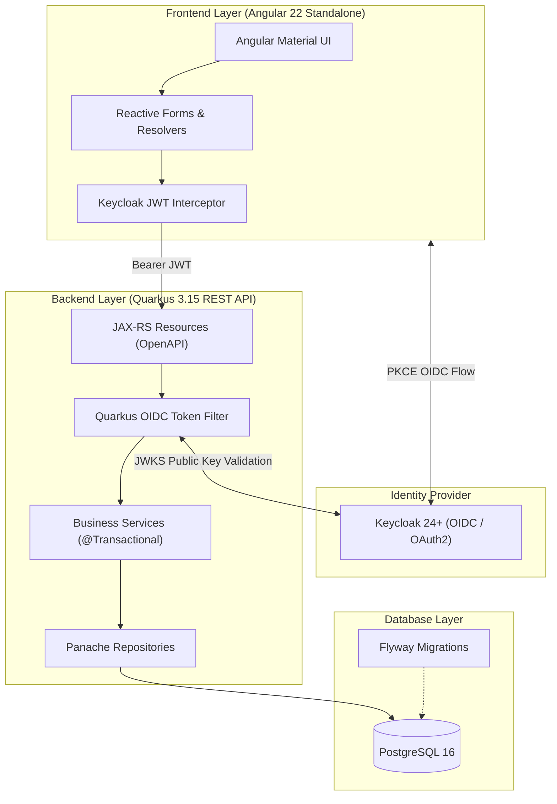

# 🐭 MouseTrap — High-Performance Gaming Mouse E-Commerce

[](https://openjdk.org/)
[](https://quarkus.io/)
[](https://angular.dev/)
[](https://www.keycloak.org/)
[](https://www.postgresql.org/)
[](https://flywaydb.org/)
[](LICENSE.md)

> **MouseTrap** is an enterprise-grade commercial e-commerce platform dedicated exclusively to high-performance gaming mice and competitive esports peripherals. Engineered with a reactive **Quarkus 3** backend, a responsive **Angular 22** standalone frontend, and **Keycloak** OpenID Connect authentication.

---

## 📑 Table of Contents

- [Vision & Domain Overview](#-vision--domain-overview)
- [System Architecture](#-system-architecture)
- [Core Features](#-core-features)
  - [Backoffice Administration](#1-backoffice-administration)
  - [Customer Storefront](#2-customer-storefront)
  - [Identity & Keycloak Authentication](#3-identity--keycloak-authentication)
- [Gaming Specifications Taxonomy](#-gaming-specifications-taxonomy)
- [Tech Stack](#-tech-stack)
- [Getting Started](#-getting-started)
  - [Prerequisites](#prerequisites)
  - [1. Database Setup (Docker PostgreSQL)](#1-database-setup-docker-postgresql)
  - [2. Backend Setup (Quarkus API)](#2-backend-setup-quarkus-api)
  - [3. Frontend Setup (Angular Web)](#3-frontend-setup-angular-web)
  - [4. Keycloak Identity Server](#4-keycloak-identity-server)
- [REST API Reference](#-rest-api-reference)
- [Testing & Quality Assurance](#-testing--quality-assurance)
- [Packaging for Academic Submission](#-packaging-for-academic-submission)
- [Version Control & Gitflow](#-version-control--gitflow)
- [AI Agents Ecosystem](#-ai-agents-ecosystem)

---

## 🎯 Vision & Domain Overview

Unlike generic online stores, **MouseTrap** caters to competitive esports players, enthusiasts, and hardware purists. The catalog tracks granular technical specifications critical to performance:

- **Optical Sensors:** PixArt PAW3395, Focus Pro 30K, HERO 2 (flawless tracking up to 32,000 DPI, 750 IPS).
- **Hyper Polling Rates:** 1000Hz (1ms), 2000Hz (0.5ms), 4000Hz (0.25ms), and 8000Hz (0.125ms).
- **Switch Technology:** Optical switches (zero debounce delay, immune to double-clicking) and mechanical switches (Kailh GM 8.0, TTC Gold).
- **Ergonomics & Grip Compatibility:** Palm, Claw, and Fingertip designs; ambidextrous vs ergonomic right-handed.
- **Ultra-Lightweight Engineering:** Sub-60g chassis optimization for rapid micro-adjustments.

---

## 🏛️ System Architecture

MouseTrap follows a decoupled multi-tier architecture organized as a unified **Monorepo** containing `api/` and `web/` modules:



---

## 🚀 Core Features

### 1. Backoffice Administration
- **Catalog Management:** Full CRUD operations for Brands (`Marca`) and Gaming Mice (`Mouse`).
- **Inventory Tracking:** Real-time stock counts, price updates, and optimistic locking to prevent concurrent overwrite.
- **Brand Protection:** Enforces relational integrity preventing deletion of brands linked to active products.
- **Customer Overview:** Directory of registered customers with delivery addresses and CEP validation.

### 2. Customer Storefront
- **Esports Catalog Browser:** Fast, responsive product catalog with server-side pagination and search.
- **Gaming Facet Filters:** Filter by connectivity (Wired, 2.4GHz Wireless, Bluetooth), polling rate, sensor model, and weight.
- **Mouse Detail Showcase:** Rich technical specifications sheet, switch feel description, and connectivity options.
- **Address Auto-Fill:** Integration with ViaCEP to automatically resolve state, city, and neighborhood upon typing a Brazilian Postal Code (CEP).

### 3. Identity & Keycloak Authentication
- OpenID Connect (OIDC) / OAuth2 with JSON Web Tokens (JWT).
- Role-Based Access Control (RBAC):
  - **`admin`**: Full backoffice catalog modification and order administration.
  - **`customer`**: Personal shopping, checkout, and order history tracking.
  - **`public`**: Unauthenticated catalog inspection and CEP query.

---

## ⚡ Gaming Specifications Taxonomy

| Specification | Supported Options / Values | Competitive Impact |
| :--- | :--- | :--- |
| **Max DPI** | 800 — 32,000+ DPI | Sensitivity scaling across ultra-wide and 4K esports monitors |
| **Polling Rate** | 1000Hz, 2000Hz, 4000Hz, 8000Hz | Reduces reporting latency from 1.0ms down to 0.125ms |
| **Sensor Model** | PixArt PAW3395, Focus Pro 30K, HERO 2 | Ensures zero smoothing, angle snapping, or spinouts |
| **Switch Type** | Optical Gen 3, Kailh GM 8.0, TTC Gold | Eliminates debounce lag; guarantees 90M+ click lifespan |
| **Weight** | Ultra-Light (<60g), Medium (60-80g), Heavy (>80g) | Determines inertia and wrist fatigue during high-velocity flicks |
| **Connectivity** | Low-Latency 2.4GHz Wireless, Bluetooth 5.2, Type-C | Sub-millisecond wireless responsiveness matching wired speeds |
| **Grip Styles** | Palm, Claw, Fingertip | Ergonomic fit matching hand size and grip posture |

---

## 💻 Tech Stack

### Backend
- **Framework:** Quarkus 3.15+ (GraalVM native-ready)
- **Language:** Java 17 LTS
- **Persistence:** Hibernate ORM with Panache (Repository Pattern)
- **Database:** PostgreSQL 16
- **Migrations:** Flyway
- **Security:** Quarkus OIDC bearer-token validation
- **Validation:** Jakarta Bean Validation (Hibernate Validator)
- **API Documentation:** OpenAPI 3.0 & Swagger UI

### Frontend
- **Framework:** Angular 22+
- **Architecture:** Standalone Components (`standalone: true`)
- **Design System:** Angular Material & SCSS
- **Forms:** Angular Reactive Forms with custom validators
- **Routing:** Functional Route Resolvers (`ResolveFn<T>`) and Route Guards
- **Testing:** Vitest & Angular Testing Library

---

## 🛠️ Getting Started

### Prerequisites
- **JDK 17** with `JAVA_HOME` configured.
- **Node.js 20+** and **npm** compatible with Angular 22.
- **Docker** & **Docker Compose** for local databases.

### 1. Database Setup (Docker PostgreSQL)
Launch a local PostgreSQL 16 instance with persistent storage:

```bash
docker run --detach --name mouse-store-postgres \
  --publish 127.0.0.1:5432:5432 \
  --env POSTGRES_DB=db \
  --env POSTGRES_USER=dbuser \
  --env POSTGRES_PASSWORD=dbpasswd \
  --volume mouse-store-postgres-data:/var/lib/postgresql/data \
  postgres:16-alpine

# Verify database readiness
docker exec mouse-store-postgres pg_isready -U dbuser -d db
```

### 2. Backend Setup (Quarkus API)
Navigate to the `api` folder, prepare local properties, and start Quarkus:

```bash
cd api

# Create local application.properties from template (ignored by Git)
test -f src/main/resources/application.properties || cp src/main/resources/application.properties.example src/main/resources/application.properties

# Start in development mode with live reload
./mvnw quarkus:dev
```

- **API Endpoint:** `http://localhost:8080`
- **Swagger UI:** `http://localhost:8080/q/swagger-ui`
- **Dev UI:** `http://localhost:8080/q/dev`

### 3. Frontend Setup (Angular Web)
Open a new terminal, navigate to the `web` folder, install dependencies, and launch:

```bash
cd web

# Install exact dependencies
npm ci

# Start development server
npm start
```

- **Application URL:** `http://localhost:4200`

### 4. Keycloak Identity Server
Start the imported realm, branded account forms and local recovery mailbox using
[the identity setup guide](docs/authentication.md). Choose a local bootstrap
password rather than committing credentials. This stack is required for sign-in;
authorized application operators must have the `admin` role in the `mousetrap` realm.


---

## 📡 REST API Reference

| Method | Endpoint | Description | Auth / Role |
| :--- | :--- | :--- | :--- |
| `GET` | `/marcas?page=0&pageSize=10` | List brands with server-side pagination | `admin` |
| `GET` | `/marcas/{id}` | Get brand details by ID | `admin` |
| `POST` | `/marcas` | Create a new brand | `admin` |
| `PUT` | `/marcas/{id}` | Update an existing brand | `admin` |
| `DELETE` | `/marcas/{id}` | Remove brand (blocked if products linked) | `admin` |
| `GET` | `/mouses?page=0&pageSize=10` | List gaming mice with specs and filters | `admin` |
| `GET` | `/mouses/{id}` | Get gaming mouse specifications by ID | `admin` |
| `POST` | `/mouses` | Register a new gaming mouse | `admin` |
| `PUT` | `/mouses/{id}` | Update mouse specifications (optimistic lock) | `admin` |
| `DELETE` | `/mouses/{id}` | Soft delete / remove mouse | `admin` |
| `GET` | `/clientes` | List customers | `admin` |
| `GET` | `/clientes/{id}` | Get customer profile | `admin` |
| `POST` | `/clientes` | Administratively create a customer | `admin` |
| `GET` / `PUT` | `/clientes/me` | Read or save own verified profile/address | `customer` / `admin` |
| `GET` | `/catalogo/mouses` | Public product browsing, facets at `/catalogo/filtros` | Public |
| `GET` | `/ceps/{cep}` | Query Brazilian postal address via ViaCEP | Public |

---

## 🧪 Testing & Quality Assurance

### Backend Automated Tests
Backend tests use `@QuarkusTest` with an isolated test profile and PostgreSQL test database:

```bash
cd api
./mvnw test
```

### Frontend Automated Tests
Frontend tests use Vitest for fast, headless execution:

```bash
cd web
npm test -- --watch=false
```

---

## 📦 Packaging for Academic Submission

To generate a minimized, clean ZIP archive for academic submission (guaranteed to exclude `.git`, `node_modules`, `target`, `.angular`, and secrets):

```bash
# Run the automated packaging script
python3 scripts/package_release.py
```

The script outputs:
- **Archive Path:** Outside `api/` and `web/` (e.g. `../mousetrap_submission_<timestamp>.zip`).
- **Compressed Size:** Typically ~200 KB.
- **Verified Inclusions:** Source code, Maven wrapper, package manifests, Flyway migrations, and documentation.
- **SHA256 Checksum** for submission authenticity.

---

## 🌿 Version Control & Gitflow

The project follows the **Atlassian Gitflow Workflow**:
- `main` — Production releases with annotated tags (`vX.Y.Z`).
- `develop` — Default integration branch for features and fixes.
- `feature/<name>` — New feature development branched from `develop`.
- `bugfix/<name>` — Fixes branched from `develop`.
- `release/<version>` — Stabilization branch prior to merging into `main`.
- `hotfix/<name>` — Urgent production fixes branched directly from `main`.

All commits follow **Conventional Commits**:
```text
feat(mouse): add optical switch latency specification
fix(cep): handle invalid postal code formats with 400 Bad Request
docs(readme): update Keycloak Docker setup instructions
```

---

## 🤖 AI Agents Ecosystem

Configured according to GitHub's findings from analyzing 2,500+ agent configurations:

- [`.github/agents/docs-agent.md`](.github/agents/docs-agent.md) — Technical documentation specialist.
- [`.github/agents/gitflow-agent.md`](.github/agents/gitflow-agent.md) — Release manager and Gitflow CLI coordinator.
- [`.github/agents/packager-agent.md`](.github/agents/packager-agent.md) — Submission archive builder.
- [`.github/agents/architect-agent.md`](.github/agents/architect-agent.md) — Enterprise e-commerce and Keycloak architect.
- [`AGENTS.md`](AGENTS.md) — Master guidelines loaded across GitHub Copilot, Antigravity, and Codex.

---

## 📄 License

This project is licensed under the MIT License — see the [LICENSE](LICENSE.md) file for details.


## Current Public Catalog Implementation

The storefront homepage, public catalog at `/catalogo`, product detail pages,
URL-managed galleries and gaming specifications are implemented. Existing
administrative routes are preserved. The public API enforces active-product and
active-brand visibility. Authentication is implemented in the third slice;
cart, transactional checkout, orders and simulated payments are now implemented. See [public catalog contracts and validation](docs/public-catalog.md)
and the [implementation backlog](docs/implementation-backlog.md).

## Authentication and owned accounts

The third slice adds Keycloak Authorization Code with PKCE, API token validation,
role enforcement, an owned customer profile and `/admin/**` navigation. Migration
V4 preserves existing customers and adds a unique identity subject. Public reads
use `/catalogo/**`; legacy administrative reads now require `admin`.
See [setup, contracts, recovery and deployment](docs/authentication.md).

### Transactional checkout

The authenticated checkout now creates historical orders, commits stock atomically, and supports local PIX/card simulation, retries, cancellation and scheduled expiry. See [checkout contracts, configuration and validation](docs/transactional-checkout.md). Customer order history and administrative fulfillment remain the next backlog slice.
