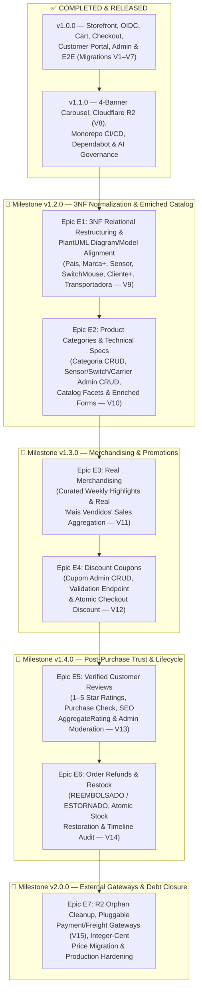
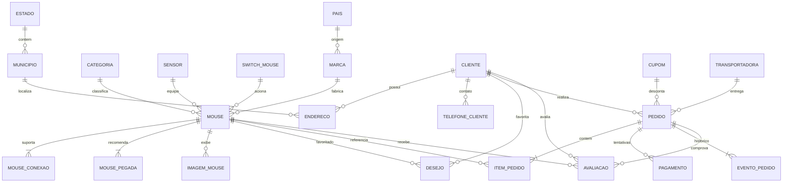

# MouseTrap — Master Visual Roadmap (`v1.0.0` → `v2.0.0`)

This document is the canonical visual and technical roadmap for MouseTrap from its
initial `v1.0.0` and `v1.1.0` releases through its final `v2.0.0` architecture.
It pairs with [active task memory](../TASK.md), [system state](SYSTEM_STATE.md),
[ADR 0002](adr/0002-post-1-1-roadmap-and-domain-evolution.md), and the GitHub
Milestones/Issues/Project board synchronized by `scripts/sync_roadmap.py`.

---

## 1. Visual Execution & Milestone Map

---

## 2. Complete Status Matrix (Done vs. In Progress vs. Planned)

| Milestone | Epic / Slice | Status | Flyway | Summary of Deliverables |
| :--- | :--- | :---: | :---: | :--- |
| **`v1.0.0`** | Slices 1–7: Storefront, Catalog, Auth, Cart, Checkout, Portal, Admin, Release Stack | ✅ **Done** | `V1`–`V7` | Public `/catalogo`, Keycloak PKCE, ViaCEP, atomic checkout/PIX/card demo, wishlist, admin orders, Playwright/Axe E2E |
| **`v1.1.0`** | Post-1.0: Carousel, R2 Uploads, Setup Guides, Dependabot, Monorepo CI/CD, AI Governance | ✅ **Done** | `V8` | 4-banner hero carousel, `POST /imagens/{mouses\|marcas}`, R2 S3 adapter, scope-aware CI/CD, 13 skills, [ADR 0001](adr/0001-record-architecture-decisions.md) |
| **`v1.2.0`** | **E1:** 3NF Database Normalization, Enriched Entities & PlantUML Reconciliation | 🔄 **Next (`#1`)** | `V9` | Normalize `Pais`, enrich `Marca`, extract `Sensor`, `SwitchMouse`, `TelefoneCliente`, `Transportadora`, link `Desejo.cliente`, update [PlantUML models](../api/docs/modelagem/README.md) |
| **`v1.2.0`** | **E2:** Product Categories (`Categoria`) & Component CRUD Screens | 📋 **Planned (`#2`)** | `V10` | `Categoria` entity/repo/service/resource, `/admin/categorias` + `/admin/sensores` + `/admin/switches` + `/admin/transportadoras`, `/catalogo` facets |
| **`v1.3.0`** | **E3:** Real Merchandising (Curated Weekly Highlights & Best-Sellers) | 📋 **Planned (`#3`)** | `V11` | `mouse.destaque` & `ordem_destaque`, real sales aggregation (`ordenar=mais-vendidos`), `GET /catalogo/mouses/destaques`, Home highlights |
| **`v1.3.0`** | **E4:** Discount Coupons (`Cupom`) | 📋 **Planned (`#4`)** | `V12` | `Cupom` entity, `/admin/cupons` CRUD, `POST /cupons/validar`, atomic checkout lock/redemption & `Pedido` discount snapshot |
| **`v1.4.0`** | **E5:** Verified Customer Reviews & Ratings (`Avaliacao`) | 📋 **Planned (`#5`)** | `V13` | Purchase-verified 1–5 star reviews, product rating summary + JSON-LD `aggregateRating`, `/admin/avaliacoes` moderation |
| **`v1.4.0`** | **E6:** Order Refunds & Stock Restoration (`Estorno`) | 📋 **Planned (`#6`)** | `V14` | `StatusPedido.REEMBOLSADO (7)`, `StatusPagamento.ESTORNADO (5)`, atomic refund + single stock restoration, `EventoPedido` audit |
| **`v2.0.0`** | **E7:** External Gateways, R2 Orphan Cleanup & Integer-Cent Migration | 📋 **Planned (`#7`)** | `V15` | R2 orphan cleanup, pluggable `PagamentoGateway`/`FreteGateway` + webhook idempotency (`V15`), integer-cent pricing, blocking Trivy |

---

## 3. Relational Normal Forms (1NF / 2NF / 3NF) & Domain Enrichment Matrix

To address the academic review of the domain model (`V1`–`V8`), the following
normalizations eliminate transitive dependencies, multi-valued contact fields,
and overly terse entities while keeping the domain focused on a gaming-mouse store:

| Domain Area | Legacy State (`V1`–`V8`) | Normal Form / Modeling Issue | Normalized 3NF Target (`V9`–`V15`) |
| :--- | :--- | :--- | :--- |
| **Manufacturer (`Marca` & `Pais`)** | `marca` had only `id`, `nome`, `ativo`, `logomarca_url`. | Overly simple entity; unnormalized country of origin and missing warranty/support metadata. | Add **`pais`** (`id`, `nome`, `sigla_iso CHAR(2) UNIQUE`) and enrich **`marca`** with `pais_origem_id`, `descricao`, `site_oficial`, `email_suporte`, `ano_fundacao`, `garantia_padrao_meses`, `versao`. |
| **Optical Sensor (`Sensor`)** | `mouse.sensor` (`varchar(100)`) and `mouse.dpi_maximo` stored inline on `mouse`. | **3NF Violation:** sensor specs (`fabricante`, `dpi_maximo`, `ips`, `aceleracao_g`) depend on the sensor model, not the individual mouse SKU. | Extract **`sensor`** (`id`, `modelo UNIQUE`, `fabricante`, `dpi_maximo`, `ips`, `aceleracao_g`, `ativo`, `versao`) referenced by `mouse.sensor_id`. |
| **Micro-Switch (`SwitchMouse`)** | `mouse.modelo_switch` (`varchar(100)`) and `mouse.tipo_switch` (`integer`) stored inline on `mouse`. | **3NF Violation (Transitive Dependency):** `mouse_id → modelo_switch → tipo_switch` (whether a switch is optical or mechanical depends on the switch model). | Extract **`switch_mouse`** (`id`, `modelo UNIQUE`, `fabricante`, `tipo_switch`, `durabilidade_milhoes_cliques`, `forca_atuacao_gf`, `ativo`, `versao`) referenced by `mouse.switch_id`. |
| **Product Category & Physical Specs (`Categoria` & `Mouse`)** | No category classification or physical dimensions on `mouse`. | Missing primary e-commerce taxonomy and physical ergonomics attributes. | Extract **`categoria`** (`id`, `nome UNIQUE`, `slug UNIQUE`, `descricao`, `ativo`, `versao`) referenced by `mouse.categoria_id`; enrich `mouse` with `comprimento_mm`, `largura_mm`, `altura_mm`, `autonomia_bateria_horas`, `garantia_meses`. |
| **Customer & Phones (`Cliente` & `TelefoneCliente`)** | `cliente` retained inline address columns (`cep`, `logradouro`, `bairro`, `numero`, `municipio_id`) alongside `endereco` (`V5`); no CPF or phones. | **Redundancy & 1NF Issue:** duplicated address data between `cliente` and `endereco`; missing customer identity/contact attributes. | Add `cpf` (`CHAR(11) UNIQUE`), `data_nascimento`, `ativo`, `versao` to `cliente`; extract **`telefone_cliente`** (`1:N`: `ddd`, `numero`, `tipo_telefone`, `principal`); remove inline address dependency from `cliente`. |
| **Wishlist (`Desejo`)** | `desejo` stored only `identidade_subject varchar(255)` and `mouse_id`. | Missing relational FK to `cliente(id)` in the database schema. | Add `cliente_id BIGINT REFERENCES cliente(id)` while preserving subject-scoped ownership verification. |
| **Carrier (`Transportadora` & `Pedido`)** | `pedido.transportadora` was a raw `varchar(100)` column (`V7`). | **3NF Violation:** carrier attributes (`cnpj`, `url_rastreio_padrao`, `prazo_medio_dias`, `valor_base_frete`) repeat across orders. | Extract **`transportadora`** (`id`, `nome UNIQUE`, `cnpj UNIQUE`, `url_rastreio_padrao`, `valor_base_frete`, `prazo_medio_dias`, `ativo`, `versao`) referenced by `pedido.transportadora_id` (preserving historical order snapshot text). |

### Target 3NF Entity-Relationship Diagram

---

## 4. End-to-End Epic Specifications (`E1` → `E7`)

### Epic E1 — 3NF Database Normalization, Enriched Entities & PlantUML Reconciliation (`v1.2.0`)

- **Branch:** `feature/e1-3nf-domain-normalization`
- **Flyway Migration:** `api/src/main/resources/db/migration/V9__normalizar_catalogo_clientes_transportadoras.sql`
  1. Create `pais` (`id`, `data_cadastro`, `data_alteracao`, `nome`, `sigla_iso CHAR(2) UNIQUE`) and seed common manufacturing countries (`US`, `CH`, `TW`, `CN`, `DE`, `JP`, `KR`, `SE`, `BR`).
  2. Alter `marca`: add `pais_origem_id BIGINT REFERENCES pais(id)`, `descricao VARCHAR(1000)`, `site_oficial VARCHAR(500)`, `email_suporte VARCHAR(254)`, `ano_fundacao INTEGER CHECK (ano_fundacao BETWEEN 1900 AND 2100)`, `garantia_padrao_meses INTEGER NOT NULL DEFAULT 12 CHECK (garantia_padrao_meses BETWEEN 1 AND 120)`, `versao BIGINT NOT NULL DEFAULT 0 CHECK (versao >= 0)`.
  3. Create `sensor` (`id`, `data_cadastro`, `data_alteracao`, `modelo VARCHAR(100) NOT NULL UNIQUE`, `fabricante VARCHAR(100) NOT NULL`, `dpi_maximo INTEGER NOT NULL CHECK (dpi_maximo > 0)`, `ips INTEGER NOT NULL DEFAULT 400 CHECK (ips > 0)`, `aceleracao_g INTEGER NOT NULL DEFAULT 40 CHECK (aceleracao_g > 0)`, `ativo BOOLEAN NOT NULL DEFAULT TRUE`, `versao BIGINT NOT NULL DEFAULT 0`); backfill distinct sensors from existing `mouse` rows.
  4. Create `switch_mouse` (`id`, `data_cadastro`, `data_alteracao`, `modelo VARCHAR(100) NOT NULL UNIQUE`, `fabricante VARCHAR(100) NOT NULL`, `tipo_switch INTEGER NOT NULL CHECK (tipo_switch IN (1, 2))`, `durabilidade_milhoes_cliques INTEGER NOT NULL DEFAULT 50 CHECK (durabilidade_milhoes_cliques > 0)`, `forca_atuacao_gf NUMERIC(5,1) CHECK (forca_atuacao_gf > 0)`, `ativo BOOLEAN NOT NULL DEFAULT TRUE`, `versao BIGINT NOT NULL DEFAULT 0`); backfill distinct switches from existing `mouse` rows.
  5. Alter `mouse`: add `sensor_id BIGINT REFERENCES sensor(id)`, `switch_id BIGINT REFERENCES switch_mouse(id)`, `comprimento_mm NUMERIC(5,1) CHECK (comprimento_mm > 0)`, `largura_mm NUMERIC(5,1) CHECK (largura_mm > 0)`, `altura_mm NUMERIC(5,1) CHECK (altura_mm > 0)`, `autonomia_bateria_horas INTEGER CHECK (autonomia_bateria_horas > 0)`, `garantia_meses INTEGER NOT NULL DEFAULT 12 CHECK (garantia_meses BETWEEN 1 AND 120)`. Populate `sensor_id` and `switch_id` from backfilled rows.
  6. Alter `cliente`: add `cpf VARCHAR(11) UNIQUE CHECK (cpf IS NULL OR cpf ~ '^[0-9]{11}$')`, `data_nascimento DATE`, `ativo BOOLEAN NOT NULL DEFAULT TRUE`, `versao BIGINT NOT NULL DEFAULT 0`; make legacy inline address columns on `cliente` nullable so `endereco` (`1:N`) is the single source of truth.
  7. Create `telefone_cliente` (`id`, `data_cadastro`, `data_alteracao`, `cliente_id BIGINT NOT NULL REFERENCES cliente(id) ON DELETE CASCADE`, `ddd CHAR(2) NOT NULL CHECK (ddd ~ '^[0-9]{2}$')`, `numero VARCHAR(9) NOT NULL CHECK (numero ~ '^[0-9]{8,9}$')`, `tipo_telefone INTEGER NOT NULL CHECK (tipo_telefone IN (1, 2, 3))`, `principal BOOLEAN NOT NULL DEFAULT FALSE`).
  8. Alter `desejo`: add `cliente_id BIGINT REFERENCES cliente(id) ON DELETE CASCADE` and backfill from `cliente.identidade_subject = desejo.identidade_subject`.
  9. Create `transportadora` (`id`, `data_cadastro`, `data_alteracao`, `nome VARCHAR(100) NOT NULL UNIQUE`, `cnpj VARCHAR(14) UNIQUE CHECK (cnpj IS NULL OR cnpj ~ '^[0-9]{14}$')`, `url_rastreio_padrao VARCHAR(500)`, `valor_base_frete NUMERIC(12,2) NOT NULL DEFAULT 0 CHECK (valor_base_frete >= 0)`, `prazo_medio_dias INTEGER NOT NULL DEFAULT 5 CHECK (prazo_medio_dias > 0)`, `ativo BOOLEAN NOT NULL DEFAULT TRUE`, `versao BIGINT NOT NULL DEFAULT 0`) and add `transportadora_id BIGINT REFERENCES transportadora(id)` to `pedido`.
- **Backend & Modeling Deliverables:**
  - Create JPA entities `Pais`, `Sensor`, `SwitchMouse`, `TelefoneCliente`, `Transportadora`, enum `TipoTelefone` + `TipoTelefoneConverter`, and update `Marca`, `Mouse`, `Cliente`, `Desejo`, `Pedido`.
  - Preserve backward-compatible fields on existing DTOs while exposing normalized objects/IDs.
  - Reconcile [diagrama-de-classes.puml](../api/docs/modelagem/diagrama-de-classes.puml), [banco-de-dados.puml](../api/docs/modelagem/banco-de-dados.puml), and [modelagem README](../api/docs/modelagem/README.md) with the 3NF model and clean up stale R2 notes in [api/README.md](../api/README.md) and [implementation-backlog.md](others/implementation-backlog.md).

---

### Epic E2 — Product Categories (`Categoria`) & Enriched Admin/Catalog UI (`v1.2.0`)

- **Branch:** `feature/e2-categories-and-enriched-catalog`
- **Flyway Migration:** `api/src/main/resources/db/migration/V10__criar_categorias.sql`
  - Create `categoria` (`id`, `data_cadastro`, `data_alteracao`, `nome VARCHAR(100) NOT NULL UNIQUE`, `slug VARCHAR(120) NOT NULL UNIQUE`, `descricao VARCHAR(500)`, `ativo BOOLEAN NOT NULL DEFAULT TRUE`, `versao BIGINT NOT NULL DEFAULT 0`) + case-insensitive unique indexes.
  - Alter `mouse`: add `categoria_id BIGINT REFERENCES categoria(id) ON DELETE RESTRICT` and index `ix_mouse_categoria`.
- **Backend & Frontend Deliverables:**
  - REST Resources & Services for `/categorias`, `/sensores`, `/switches`, `/transportadoras`, and `/paises` (`@RolesAllowed("admin")` for mutations).
  - Public catalog filtering by `idCategoria`, `idSensor`, `idSwitch` on `GET /catalogo/mouses` and `GET /catalogo/filtros`.
  - Angular standalone CRUD screens under `/admin/categorias`, `/admin/sensores`, `/admin/switches`, `/admin/transportadoras`, plus enriched `/admin/marcas`, `/admin/mouses`, `/admin/clientes`, `/meus-dados`, and `/catalogo` filter facets.

---

### Epic E3 — Real Merchandising: Curated Weekly Highlights & Best-Sellers (`v1.3.0`)

- **Branch:** `feature/e3-merchandising-highlights-bestsellers`
- **Flyway Migration:** `api/src/main/resources/db/migration/V11__adicionar_destaque_mouse.sql`
  - Add `destaque BOOLEAN NOT NULL DEFAULT FALSE` and `ordem_destaque INTEGER CHECK (ordem_destaque IS NULL OR ordem_destaque >= 0)` to `mouse`.
- **Backend & Frontend Deliverables:**
  - `ordenar=mais-vendidos` in `CatalogoServiceImpl` using real paid/shipped/delivered `ItemPedido` quantities.
  - `GET /catalogo/mouses/destaques` endpoint powering the homepage "Destaques da Semana" section, and admin highlight controls in `/admin/mouses`.

---

### Epic E4 — Discount Coupons (`Cupom` — `v1.3.0`)

- **Branch:** `feature/e4-discount-coupons`
- **Flyway Migration:** `api/src/main/resources/db/migration/V12__criar_cupons_desconto.sql`
  - Create `cupom` (`id`, `codigo`, `descricao`, `tipo_desconto` `1=PERCENTUAL / 2=VALOR_FIXO`, `valor_desconto`, `valor_minimo_pedido`, `limite_usos`, `quantidade_usada`, `valido_de`, `valido_ate`, `ativo`, `versao`, audit columns).
  - Alter `pedido`: add `cupom_id BIGINT REFERENCES cupom(id)`, `codigo_cupom VARCHAR(40)`, `valor_desconto NUMERIC(12,2) NOT NULL DEFAULT 0.00`.
- **Backend & Frontend Deliverables:**
  - Admin CRUD `/cupons` (`@RolesAllowed("admin")`), customer preview `POST /cupons/validar`, and atomic coupon redemption/restoration in `PedidoServiceImpl`.
  - Coupon field and discount breakdown in `/carrinho`, `/checkout`, `/meus-pedidos/:id`, and `/admin/pedidos/:id`.

---

### Epic E5 — Verified Customer Reviews & Ratings (`Avaliacao` — `v1.4.0`)

- **Branch:** `feature/e5-customer-reviews`
- **Flyway Migration:** `api/src/main/resources/db/migration/V13__criar_avaliacoes_produto.sql`
  - Create `avaliacao` (`id`, `mouse_id`, `cliente_id`, `pedido_id`, `nota` `1..5`, `titulo`, `comentario`, `visivel`, `versao`, audit columns, `UNIQUE(cliente_id, mouse_id)`).
- **Backend & Frontend Deliverables:**
  - Purchase-verified review creation (`POST /catalogo/mouses/{id}/avaliacoes`), public paged reviews (`GET /catalogo/mouses/{id}/avaliacoes`), aggregate rating fields on catalog DTOs + JSON-LD `aggregateRating` in `SeoService`, and admin moderation (`PATCH /admin/avaliacoes/{id}/visibilidade`).

---

### Epic E6 — Order Refunds & Stock Restoration (`Estorno` — `v1.4.0`)

- **Branch:** `feature/e6-order-refunds`
- **Flyway Migration:** `api/src/main/resources/db/migration/V14__adicionar_estorno_pedido_pagamento.sql`
  - Expand `pedido.status` check to include `7` (`REEMBOLSADO`) and `pagamento.status` check to include `5` (`ESTORNADO`); add `estornado_em TIMESTAMPTZ` and `motivo_estorno VARCHAR(300)`.
- **Backend & Frontend Deliverables:**
  - Atomic refund endpoint (`POST /admin/pedidos/{id}/estornar` and customer self-service refund request for unshipped `PAGO` orders), restoring stock once and recording an immutable `EventoPedido`.

---

### Epic E7 — External Gateways, R2 Cleanup & Integer-Cent Migration (`v2.0.0`)

- **Branch:** `feature/e7-gateways-r2-cleanup-integer-cents`
- **Flyway Migration:** `api/src/main/resources/db/migration/V15__criar_eventos_webhook.sql`
  - Create `evento_webhook_pagamento` for idempotent external payment webhook deduplication.
- **Backend, Frontend & CI/CD Deliverables:**
  - Admin R2 orphan image inspection/cleanup service; pluggable `PagamentoGateway` and `FreteGateway` adapters; integer-cent price fields (`precoCentavos`) for exact client math; blocking Trivy scan enforcement in `.github/workflows/{verify,cd}.yml`.

---

## 5. Continuous Execution Protocol (Zero Planning Pauses)

1. **Sync Visual Board:** Run `python3 scripts/sync_roadmap.py --dry-run` (or `--apply` when publishing to GitHub Milestones/Issues/Projects).
2. **Start Next Epic:** Checkout `develop`, create the epic's branch (`git checkout -b feature/eN-...`), and load its checklist from this roadmap into [TASK.md](../TASK.md).
3. **Implement & Verify:** Follow the applicable skills (`db-migration-safe`, `persistencia-postgresql`, `quarkus-backend`, `angular-frontend`, `testes-backend`, `testes-frontend`) and run `python3 scripts/ai_checks.py verify --scope <scope>`.
4. **Advance Automatically:** Upon merging the epic PR into `develop`, mark the epic `Done` in `docs/ROADMAP.md`, `TASK.md`, and `scripts/sync_roadmap.py`, and immediately queue the next epic in sequence.

