# MouseTrap Design System & Architectural SVG Wireframes

This directory contains the unified visual identity, Angular Material M3 theming rules, Dribbble reference synthesis, and **12 full-resolution (`1440x900`) minimalist SVG wireframes** for the **MouseTrap** esports e-commerce platform.

---

## 1. Core Design Principles

1. **Generous Whitespace & Visual Breathing Room:** Inspired by editorial landing pages (*Verone*, *Arbora*, *Smart Water Bottle*) and modern SaaS admin dashboards (*Saledash*), every screen prioritizes clean spacing (`60%+` neutral canvas/white surfaces), clear typography, and low cognitive density.
2. **Strict Container Containment:** Every card, badge, input, and button maintains comfortable internal padding so no text or child element ever touches or overflows its container border.
3. **100% User-Facing Copy (Zero Architecture Jargon):** Backend, authentication, and database implementation details (such as `Keycloak`, `OIDC`, `JWT`, `Roles`, `@Version`, or API route paths) are never exposed in the UI.
4. **Unified Single Login Screen (`/login`):** All users sign in through a single minimalist Login screen. After authentication, the application redirects the user automatically according to their role (`ADMIN` → `/admin/pedidos`, `CLIENTE` → Storefront).

---

## 2. Unified Color Palette & Extended Neutral/Semantic Scale

| Token | Hex | CSS Variable | Primary Role & Contrast Guidance |
| :--- | :--- | :--- | :--- |
| **Prussian Blue** | `#0a122a` | `--prussian-blue` | Primary ink, high-contrast typography, Admin sidebar, Hero banners, primary dark buttons (`18.1:1` on white — AAA). |
| **Slate Blue** | `#7d53de` | `--slate-blue` | Primary interactive brand color (Angular Material M3 Primary), active tabs, focus rings, filter badges (`4.9:1` on white — AA). |
| **Golden Glow** | `#dacc3e` | `--golden-glow` | High-conversion CTA fill ("Comprar Agora", "Adicionar", "Entrar"). **Always paired with `#0a122a` text (`11.2:1` — AAA).** |
| **Light Cyan** | `#d1f5ff` | `--light-cyan` | Concise technical tags (`8000 Hz`, `Sem Fio`), active highlights, radial hero glow. **Always paired with `#0a122a` text.** |
| **Alice Blue** | `#eef8ff` | `--alice-blue` | Product image stages, secondary filter fills, table header backgrounds (`30%` secondary surface). |
| **Pure White** | `#ffffff` | `--surface-pure` | Elevated cards, product tiles, data tables, dialogs, form inputs (`60%` dominant surface). |
| **Surface Canvas** | `#f6f9fc` | `--surface-canvas` | App-wide background canvas for Storefront and Admin Backoffice. |

---

## 3. Complete Screen Wireframe Index (12 SVGs)

### `00-design-system-tokens.svg` — Design System, Color Palette, Typography & Material M3 Kit
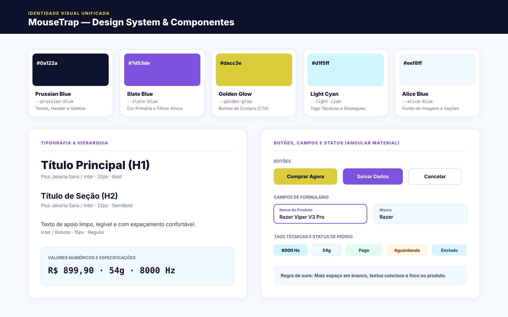

---

### `01-storefront-home.svg` — Storefront Landing Page (`/`)
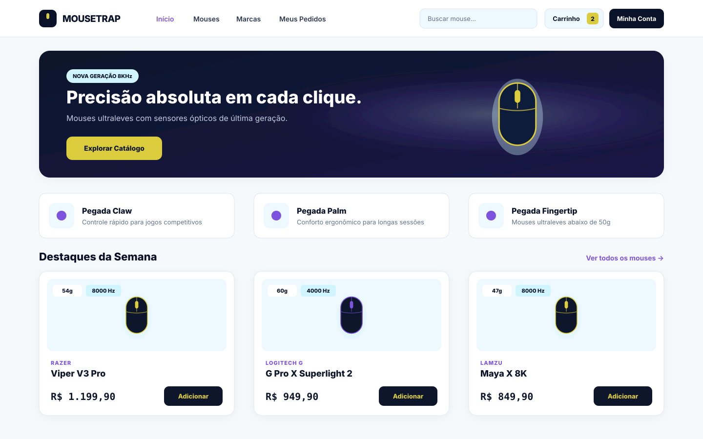

---

### `02-storefront-catalog.svg` — Storefront Product Catalog & Facet Filters (`/mouses`)
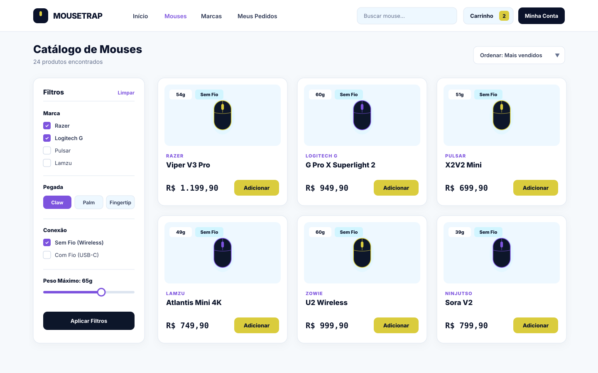

---

### `03-storefront-product-detail.svg` — Storefront Product Detail Page (`/mouses/:id`)
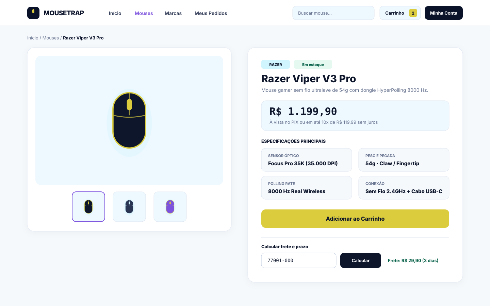

---

### `04-storefront-cart.svg` — Storefront Shopping Cart (`/carrinho`)
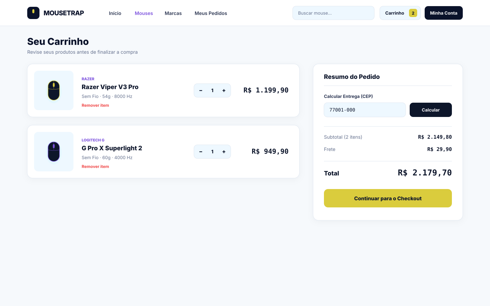

---

### `05-storefront-checkout.svg` — Storefront Checkout (`/checkout`)
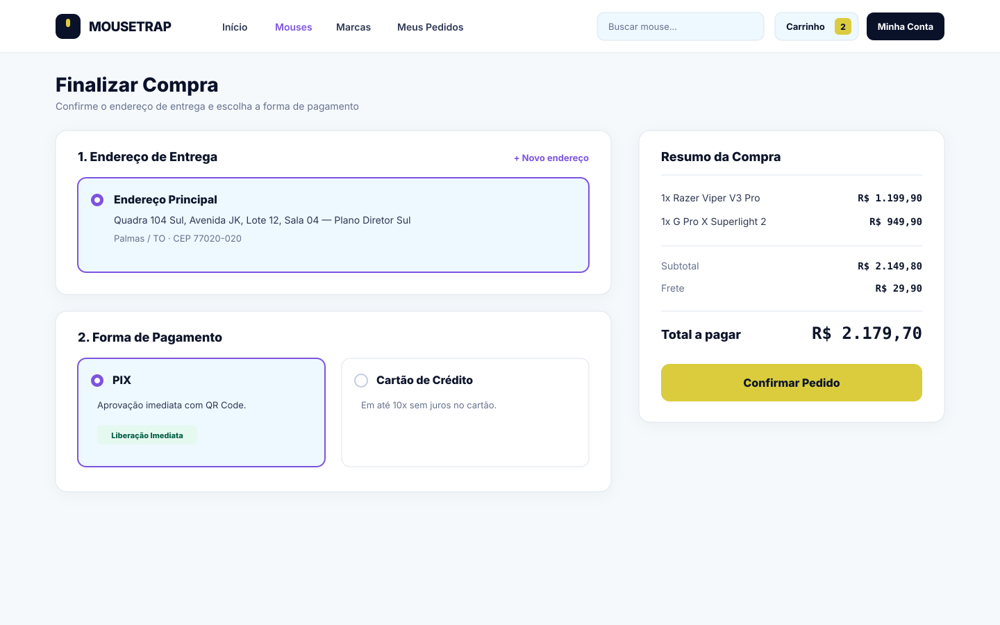

---

### `06-storefront-customer-portal.svg` — Customer Portal: My Orders & Tracking (`/meus-pedidos`)
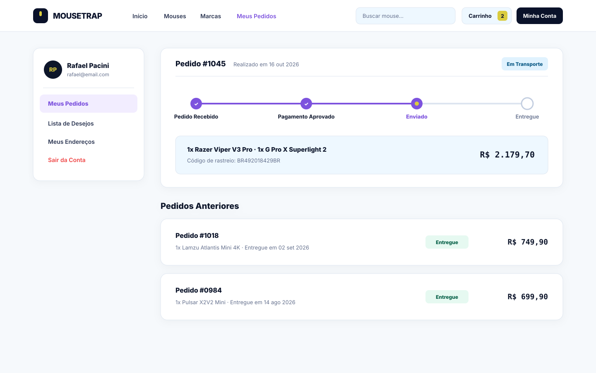

---

### `07-auth-login.svg` — Unified Single Login Screen (`/login`)
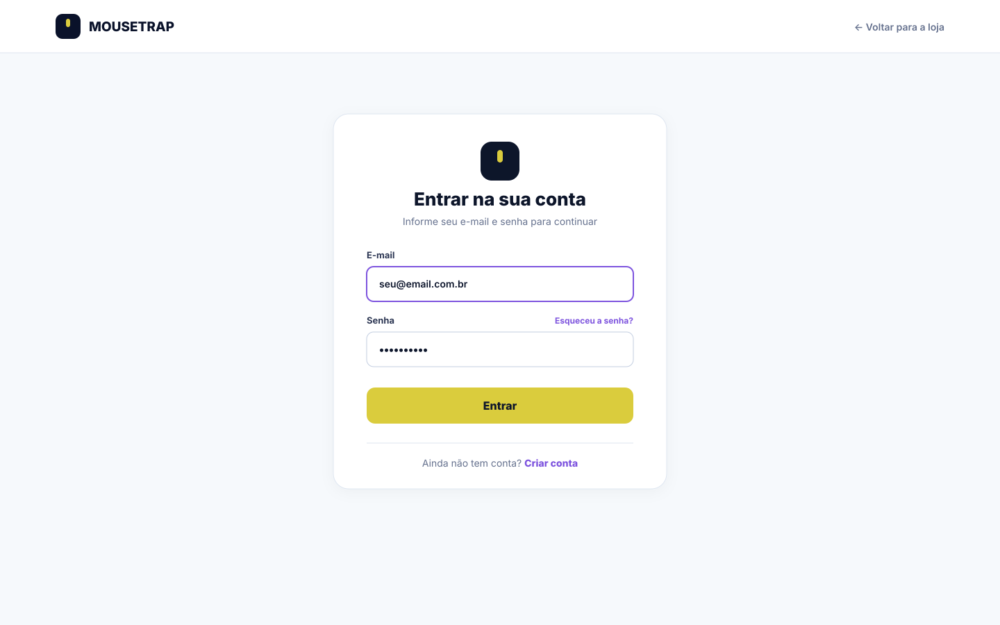

---

### `08-auth-register.svg` — Customer Registration Screen (`/cadastro`)
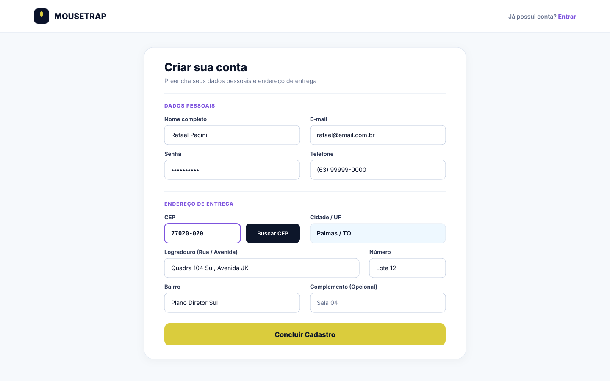

---

### `09-admin-dashboard-orders.svg` — Admin Executive Dashboard & Orders Management (`/admin/pedidos`)
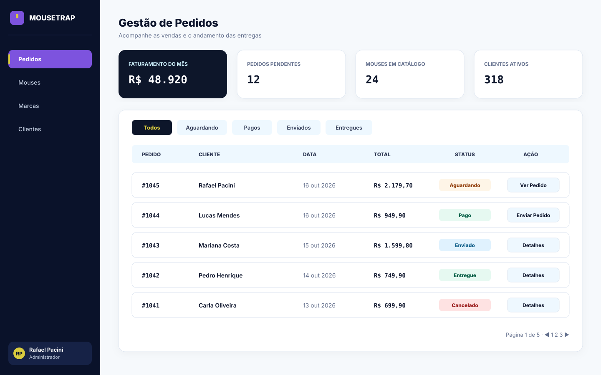

---

### `10-admin-catalog-list.svg` — Admin Catalog: Products List (`/admin/mouses`)
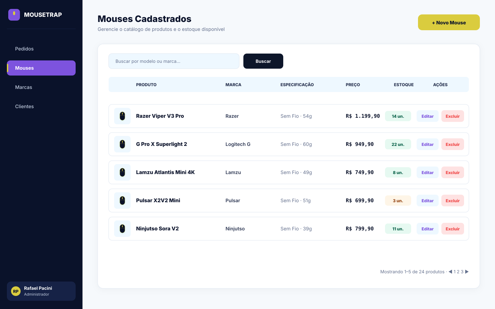

---

### `11-admin-catalog-form.svg` — Admin Catalog: Product Create/Edit Form (`/admin/mouses/novo`)
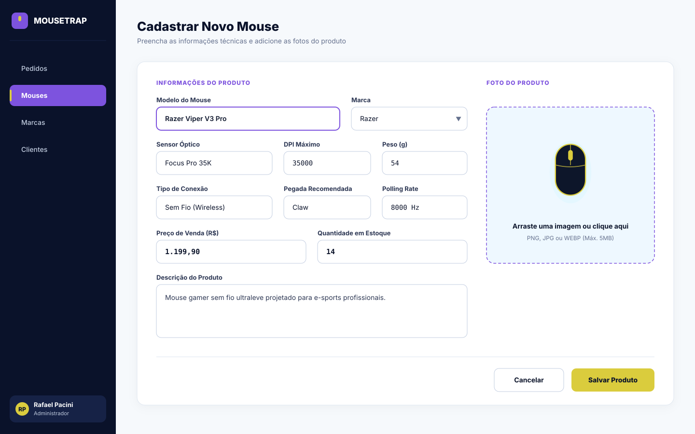
